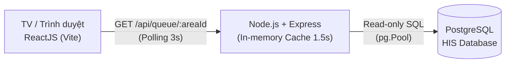

# Thiết kế Hệ thống Màn Hình Chờ Độc Lập (MHC)

**Ngày:** 2026-11-17  
**Thư mục dự án:** `D:\WorkSpace\Projects\MHC`  
**Công nghệ:** Node.js (Express + `pg`) & ReactJS (Vite)

---

## 1. Mục tiêu & Bối cảnh

Hệ thống Màn hình chờ (MHC) cũ của HIS (`:55636`) phụ thuộc vào việc máy trạm HIS bắn sự kiện qua Message Hub (`CHANGE_INFO`) hoặc phải tải lại trang (F5) thủ công, đồng thời có các bất cập về hiển thị:
- Không tự động cập nhật khi bác sĩ phòng khám chỉ định dịch vụ mới sang phòng Cận lâm sàng (CĐHA, TDCN, Xét nghiệm).
- Bỏ sót bệnh nhân nội trú (`ipd_queue_flag = true`), bệnh nhân có chỉ định mới trên lượt chờ từ ngày hôm trước, hoặc bệnh nhân bị `active_status = false` khi chỉ định từ 2 dịch vụ cùng phòng trở lên.
- Bố cục 1 cột chữ quá lớn làm khuất danh sách chờ phía dưới, không phân tách rõ khu vực **Đang mời vào / Đang thực hiện** (`active_flag = 2`) và **Danh sách chờ** (`active_flag = 1`, `6`).

Dự án **MHC** xây dựng một ứng dụng Web độc lập (Backend Node.js kết nối trực tiếp PostgreSQL ở chế độ chỉ đọc + Frontend ReactJS) chạy ổn định 24/7 trên TV/màn hình tại các Phòng khám và Phòng Cận lâm sàng của Bệnh viện Đa khoa Hùng Cường.

---

## 2. Kiến trúc tổng thể



### 2.1. Nguyên tắc thiết kế
1. **An toàn tuyệt đối cho DB HIS:** Chỉ sử dụng các câu lệnh `SELECT` (Read-Only), không gắn Trigger hay sửa đổi dữ liệu từ ứng dụng MHC.
2. **Chịu tải cao & Bền bỉ 24/7:**
   - Frontend ReactJS tự động gọi `GET /api/queue/:areaId` mỗi **3 giây**.
   - Backend Node.js lưu cache kết quả theo từng `areaId` trong **1.5 giây** trên RAM. Dù có nhiều TV cùng mở một phòng, DB chỉ nhận tối đa 1 truy vấn mỗi 1.5 giây (~2–5ms).
   - Khi mất kết nối mạng tạm thời, giao diện TV giữ nguyên danh sách gần nhất (không trắng màn hình) và hiển thị trạng thái mất kết nối nhỏ ở góc trên bên phải; tự động khôi phục ngay khi có mạng lại.
3. **Tương thích hoàn toàn URL của HIS:**
   - `/subclinical-queue/:areaId`: Màn hình chờ phòng Cận lâm sàng (CĐHA, Nội soi, Siêu âm, X-Quang, Điện tim, Xét nghiệm...).
   - `/clinical-queue/:areaId`: Màn hình chờ Phòng khám.
   - `/`: Trang chủ tìm kiếm & chọn nhanh phòng để mở trên TV.
   - Khi build Production, Express phục vụ cả API (`/api/*`) và static files của React trên cùng 1 cổng (mặc định `PORT=55637`, cấu hình qua `.env`).

---

## 3. Thiết kế Backend (`server/`)

### 3.1. Cấu trúc thư mục
```text
D:\WorkSpace\Projects\MHC\server\
├── src/
│   ├── config/
│   │   └── db.js               # Khởi tạo pg.Pool từ biến môi trường (.env)
│   ├── services/
│   │   ├── cache.js            # In-memory TTL cache (1500ms)
│   │   └── queueService.js     # Truy vấn danh sách phòng, thông tin phòng, hàng chờ
│   ├── routes/
│   │   └── api.js              # Định nghĩa REST endpoints (/api/health, /api/areas, /api/queue/:areaId)
│   └── app.js                  # Cấu hình Express, CORS, static serving, SPA fallback
├── index.js                    # Điểm khởi chạy HTTP server
├── test/
│   └── api.test.js             # Unit/Integration test với node:test
├── .env.example                # Mẫu cấu hình môi trường
└── package.json
```

### 3.2. Đặc tả API

#### 1. `GET /api/health`
- Kiểm tra trạng thái server và kết nối DB.
- **Response `200 OK`:**
  ```json
  { "status": "ok", "db": true, "timestamp": "2026-11-17T10:30:00.000Z" }
  ```

#### 2. `GET /api/areas`
- Trả về danh sách các phòng đang hoạt động để hiển thị ở trang chọn phòng (`/`), kèm số lượng bệnh nhân đang chờ thực tế trong ngày.
- **SQL truy vấn:** Lấy từ bảng `area` (`active_flag = 1`, `area_type_rcd IN ('CLR', 'RAR', 'BLD', 'WAI')`) kết hợp đếm nhanh số lượt chờ trong ngày.
- **Response `200 OK`:**
  ```json
  {
    "areas": [
      {
        "area_id": "73c84d7a-b0a4-4e71-981a-ff8d94641cf1",
        "area_name": "Phòng nội soi tiêu hóa P311",
        "area_type_rcd": "RAR",
        "queue_type": "subclinical",
        "waiting_count": 5
      }
    ]
  }
  ```

#### 3. `GET /api/queue/:areaId`
- Trả về thông tin chi tiết của phòng và danh sách bệnh nhân trong hàng chờ.
- **Logic truy vấn:**
  1. Lấy thông tin phòng từ bảng `area` (`area_id`, `area_name_l`, `area_type_rcd`).
  2. Lấy thông tin bác sĩ / điều dưỡng trực tại phòng trong ngày (nếu có trong `work_calendar` hoặc lượt khám đang thực hiện).
  3. Lấy danh sách bệnh nhân từ hàm `sp_processing_queue_screen_saver_clinical(p_area_id)` (bản đã chuẩn hóa hiển thị nội trú CLS, lượt chờ có chỉ định mới hôm nay, và xử lý `active_status = false` cho CLS).
  4. Tách danh sách trả về thành 3 nhóm rõ ràng để Frontend dễ hiển thị:
     - `calling`: các bản ghi có `active_flag = 2` (Đang mời vào / Đang thực hiện).
     - `waiting`: các bản ghi có `active_flag IN (1, 4)` (Đang chờ khám / chờ thực hiện).
     - `waitingResult`: các bản ghi có `active_flag = 6` (Chờ kết quả CLS — dùng cho phòng khám).
     - `missed`: các bản ghi có `active_flag = 10` (Qua lượt — nếu có).
- **Response `200 OK`:**
  ```json
  {
    "area": {
      "area_id": "73c84d7a-b0a4-4e71-981a-ff8d94641cf1",
      "area_name": "Phòng nội soi tiêu hóa P311",
      "area_type_rcd": "RAR",
      "queue_type": "subclinical",
      "doctor_name": null,
      "nurse_name": null
    },
    "summary": {
      "total": 5,
      "calling_count": 1,
      "waiting_count": 4,
      "waiting_result_count": 0
    },
    "calling": [
      {
        "patient_id": "6cda822a-7d46-437b-a535-d007e48ef1ef",
        "patient_name": "MẪN THỊ HOA",
        "seq_num": "03",
        "age": 55,
        "year_of_birth": 1971,
        "gender": 0,
        "priority": false,
        "active_flag": 2,
        "recomment": null
      }
    ],
    "waiting": [
      {
        "patient_id": "...",
        "patient_name": "ĐẶNG THỊ LỰC",
        "seq_num": "05",
        "age": 84,
        "year_of_birth": 1942,
        "gender": 0,
        "priority": false,
        "active_flag": 1,
        "recomment": null
      }
    ],
    "waitingResult": [],
    "missed": [],
    "updated_at": "2026-11-17T10:30:00.000Z"
  }
  ```

---

## 4. Thiết kế Frontend (`client/`)

### 4.1. Cấu trúc thư mục
```text
D:\WorkSpace\Projects\MHC\client\
├── src/
│   ├── api/
│   │   └── queueApi.js            # Hàm fetch /api/areas và /api/queue/:areaId
│   ├── components/
│   │   ├── HeaderBar.jsx          # Header: Tên BV, Tên phòng, Đồng hồ, Trạng thái mạng, Nút Loa/Fullscreen
│   │   ├── CallingPanel.jsx       # Cột trái: Bệnh nhân ĐANG THỰC HIỆN / MỜI VÀO PHÒNG (active_flag = 2)
│   │   └── WaitingListPanel.jsx   # Cột phải: Danh sách ĐANG CHỜ (tự cuộn mượt nếu vượt chiều cao)
│   ├── pages/
│   │   ├── AreaSelectorPage.jsx   # Trang "/" tìm & chọn phòng
│   │   └── QueueScreenPage.jsx    # Trang màn hình chờ (/subclinical-queue/:areaId & /clinical-queue/:areaId)
│   ├── utils/
│   │   └── sound.js               # Chuông báo Ding-Dong bằng Web Audio API (không phụ thuộc file âm thanh ngoài)
│   ├── App.jsx                    # Khai báo React Router
│   ├── index.css                  # Giao diện tối ưu cho TV 16:9 (chữ đậm, độ tương phản cao)
│   └── main.jsx
├── index.html
├── vite.config.js                 # Proxy /api sang cổng Backend khi chạy dev
└── package.json
```

### 4.2. Bố cục giao diện Màn hình chờ (Tối ưu TV FullHD / 4K 16:9)

1. **Thanh Header (chiếm ~12% chiều cao):**
   - Bên trái: Tên bệnh viện (**BỆNH VIỆN ĐA KHOA HÙNG CƯỜNG**) + Tên phòng cỡ lớn, nổi bật (ví dụ: **PHÒNG NỘI SOI TIÊU HÓA P311**).
   - Bên phải: Đồng hồ thời gian thực (`HH:mm:ss - DD/MM/YYYY`), Tổng số chờ, nút Bật/Tắt chuông báo và nút Toàn màn hình (ẩn gọn khi không di chuột).
2. **Thân màn hình chia 2 cột (chiếm ~88% chiều cao):**
   - **Cột Trái (42% chiều rộng) — ĐANG MỜI VÀO / ĐANG THỰC HIỆN (`calling`):**
     - Nền màu xanh lá đậm / viền sáng nổi bật.
     - Mỗi thẻ bệnh nhân hiển thị: **Số thứ tự lớn (`03`)**, **Họ và tên in hoa (`MẪN THỊ HOA`)**, **Tuổi / Năm sinh (`55 tuổi - 1971`)**, nhãn **ƯU TIÊN** (nếu `priority = true`).
     - Khi phát hiện bệnh nhân mới chuyển sang `active_flag = 2`: phát âm báo **Ding-Dong** qua Web Audio API và nhấp nháy thẻ bệnh nhân trong 5 giây.
     - Nếu chưa có ai ở trạng thái `active_flag = 2`: hiển thị thông báo nhẹ *"Đang chuẩn bị gọi bệnh nhân tiếp theo"*.
   - **Cột Phải (58% chiều rộng) — DANH SÁCH CHỜ TIẾP THEO (`waiting` & `waitingResult`):**
     - Bảng danh sách rõ ràng gồm: **STT**, **Họ và tên**, **Tuổi / Năm sinh**, **Trạng thái** (`Đang chờ`, `Ưu tiên`, hoặc `Chờ KQ CLS` đối với phòng khám).
     - **Tự động cuộn mượt (Auto-scroll):** Khi số dòng vượt quá chiều cao khung nhìn, danh sách tự động cuộn từ trên xuống dưới, dừng 3 giây ở cuối rồi cuộn lại lên đầu.

---

## 5. Xử lý lỗi & Kiểm thử

1. **ID phòng không hợp lệ hoặc không tồn tại:**
   - API trả về `404 Not Found` nếu `areaId` không đúng định dạng UUID hoặc không có trong bảng `area`.
   - Giao diện hiển thị thông báo rõ ràng kèm nút quay về trang chọn phòng (`/`).
2. **Mất kết nối mạng / Backend khởi động lại:**
   - Giữ nguyên dữ liệu lần thành công gần nhất trên màn hình TV, hiển thị biểu tượng cảnh báo nhỏ màu cam ở góc Header, tự động thử lại mỗi 3 giây.
3. **Kiểm thử:**
   - Backend: Test tự động bằng `node --test` kiểm tra cache, định dạng UUID, API `/api/health`, `/api/areas`, và `/api/queue/:areaId` (với phòng thực tế P311 `73c84d7a-b0a4-4e71-981a-ff8d94641cf1` và P302 `50a1993f-c63d-4a09-accb-2cda6d788a5c`).
   - Frontend: Kiểm tra build production (`npm run build`) không lỗi và kiểm tra hiển thị trên cả 3 route `/`, `/subclinical-queue/:areaId`, `/clinical-queue/:areaId`.
